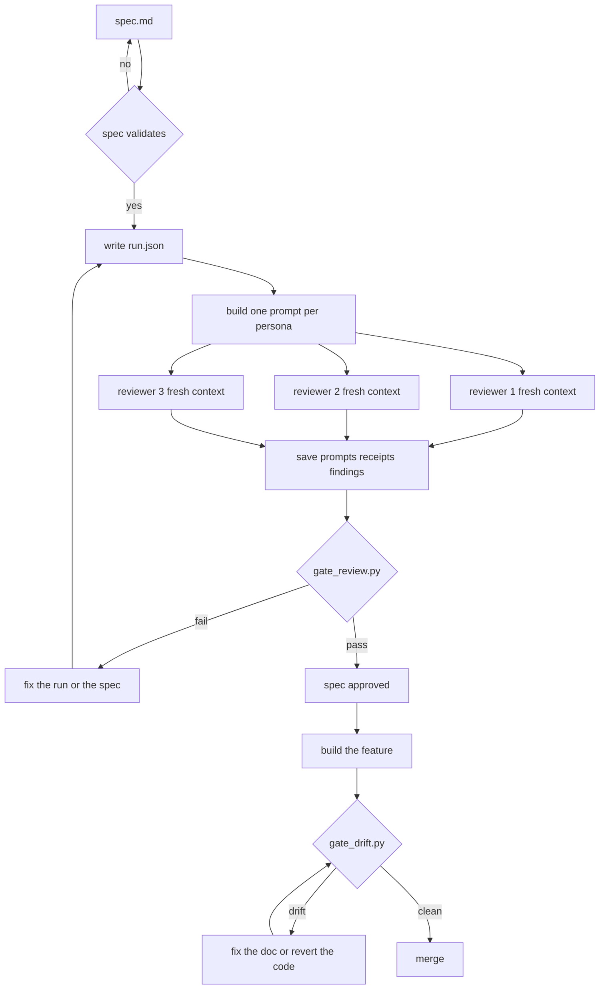

# design-gate

Two small skills that check a design review instead of trusting it.

A review that nobody can check is a review you took on faith. These skills turn a
design review into files a script can reject: the exact prompt each reviewer
received, the spec version they all saw, and a `fixed` decision that needs the
document changed *and* a later round to agree.

It is a personal tool, published in case it is useful. MIT, no support promised.

## What it solves

| Problem | What this does |
|---|---|
| An agent reviews the spec it just wrote, in the same conversation, and reports a fresh-eyes review | reviewers get a fixed prompt with no conversation in it; any line outside the template fails the run |
| "Fresh context" is a sentence in the procedure, and nobody checks it | the prompt is stored and compared against the template, the spec and the persona on disk |
| Findings marked "resolved" that were never written | `fixed` requires the document to change and the next round to say `resolved` for that id |
| Documentation that described the code six months ago | the spec's factual claims are checked against the repo, and the doc against the version that was approved |

## Install

**Ask your agent.** Paste this into Claude Code, Codex, Antigravity or Hermes:

> Install https://github.com/dandrok/design-gate

<details>
<summary>Or run the installer yourself</summary>

```bash
# Hermes
hermes plugins install dandrok/design-gate --no-enable
hermes plugins enable design-gate

# Claude Code
claude plugin marketplace add dandrok/design-gate
claude plugin install design-gate@design-gate

# Codex
codex plugin marketplace add dandrok/design-gate
codex plugin add design-gate@design-gate
```
</details>

Bring a spec that already passes
[`spec-writer`](https://github.com/dandrok/dev-flow-skills)'s `validate-spec.py` —
this tool checks reviews, it does not write specifications.

## How it works

```
spec.md
  |  validate-spec.py  -- fails --> fix the spec
  v
run.json                      personas, allowlist, rounds
  |
  v
one prompt per persona       template + persona + spec + cited sources
  |
  +-- reviewer 1  (fresh context)
  +-- reviewer 2  (fresh context)
  +-- reviewer 3  (fresh context)
  |
  v
prompts/ receipts/ findings/  what each reviewer actually saw
  |
  v
gate_review.py -- fail --> fix the run or the spec --> back to run.json
  |
  pass
  v
spec approved --> build the feature --> gate_drift.py
                                            |
                            +---------------+---------------+
                            |                               |
                          drift                           clean
                            |                               |
                 fix the doc or revert                    merge
                            |
                            +--> re-run gate_drift.py
```

<details>
<summary>Mermaid version, if your viewer renders it</summary>



</details>

What the gate refuses:

| Refused | Because |
|---|---|
| a prompt with any line that is not template text | that line came from the conversation — the reviewer was not fresh |
| reviewers holding different versions of the spec | they agreed on different documents, which is not agreement |
| a source outside the allowlist, or a transcript | the reviewer was handed the discussion it was supposed to be blind to |
| a receipt whose inputs differ from the prompt | the run describes an isolation that did not happen |
| a finding against a section that does not exist | the reviewer invented structure |
| a `clean` verdict after one named check | nobody read the document |
| a spec that fails its own validator | reviewing a document that cannot be built is theatre |
| `fixed` with an unchanged document | the fix was asserted, not written |
| a `fixed` the next round reopened | the fix did not hold |

## Quickstart

```bash
mkdir -p docs/specs/webhooks/review/{prompts,receipts,findings}

# 1. one prompt per persona, filled from the only allowed template
python3 resources/templates/fill_prompt.py \
  --template resources/templates/review_prompt.md \
  --persona agents/implementability.md \
  --spec docs/specs/webhooks/spec.md --root . \
  --source src/webhooks/deliver.ts \
  --out docs/specs/webhooks/review/prompts/implementability.r1.txt

# 2. dispatch one fresh subagent per prompt, save what it returns
#    (delegate_task in Hermes, Task subagent in Claude Code — see the skill)

# 3. write run.json, receipts/, findings/, resolutions.json
# 4. judge the run
python3 skills/design-review/scripts/gate_review.py docs/specs/webhooks/review \
  --spec-gate ~/.hermes/skills/software-development/spec-writer/scripts/validate-spec.py

# after implementation
python3 skills/design-drift/scripts/gate_drift.py docs/specs/webhooks/spec.md \
  --root . --run docs/specs/webhooks/review
```

## Layout

```
plugin.json
agents/                          five reviewer personas, one question each
resources/templates/
  review_prompt.md               the only allowed wrapper
  fill_prompt.py                 fills it; imported by the test fixture too
skills/design-review/
  SKILL.md                       procedure producing the artifacts
  scripts/gate_review.py         isolation, coverage, findings, resolutions
  tests/                         25 cases
skills/design-drift/
  SKILL.md
  scripts/gate_drift.py          claims vs repo, lineage vs review
  tests/                         14 cases
tests/run-all.sh                 every skill's own suite, one total
docs/pilot.md                    two cold rounds against a real spec
```

## What is verified, and what is not

Verified by running `tests/run-all.sh` — **39/39 cases** (25 review, 14 drift). The
clean run is approved; each other case seeds one defect and asserts the gate's
*message*, not just its exit code. Two cold pilot rounds are recorded in
[`docs/pilot.md`](docs/pilot.md): 23 findings in round 1, 21 verified fixed in round
2, 2 reopened by the reviewer that raised them.

Not verified, stated plainly:

- **Spec-gate integration is exercised with a test double**, not spec-writer's real
  validator. The suite proves the wiring: exit 0 passes, exit 1 blocks approval.
- **Reviewer quality has one data point and it is not flattering.** The pilot found
  plenty and missed the one defect planted deliberately.
- **The gate verifies artifacts, not the transport.** A dispatcher that writes a
  clean prompt and never sends it passes. It catches sloppiness and self-deception,
  not a determined liar — what it does give you is evidence you can re-read later.

## Limits

- Claims cover only what a grep can settle: paths, symbols, endpoints, tables,
  runnable commands.
- `command:` claims are not executed unless you pass `--run-commands`.
- The review gate needs a spec with `## ` headings; fewer than three is rejected as
  too little to review.
- Reviewers see prose and the sources you cite, not your architecture. A design
  flaw that only shows in the import graph will not be caught here.

## Licence

MIT — see [LICENSE](LICENSE). Prior art credited in [NOTICE.md](NOTICE.md).
