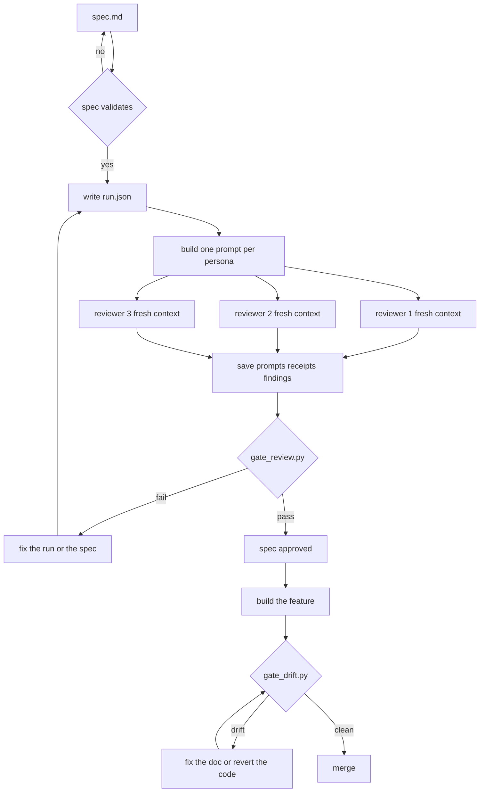

# design-gate

**Your agent reviews specs with fresh-context subagents. This proves it.**

A review that nobody can check is a review you have to take on faith. `design-gate`
turns a design review into artifacts a script rejects: the exact prompt each
reviewer received, the spec version they all saw, and a `fixed` decision that needs
the document changed *and* a later round to agree.

## Install

**Ask your agent.** Paste this into Claude Code, Codex, Antigravity or Hermes:

> Install https://github.com/dandrok/design-gate

It runs the host's own installer (`hermes plugins install`, `claude plugin
marketplace add`, `codex plugin marketplace add`), drops both skills in place, and
confirms the two gate scripts run. Nothing to configure.

<details>
<summary>Or the commands, if you prefer to see them</summary>

```bash
# Hermes — portable package, skills land namespaced and read-only
hermes plugins install dandrok/design-gate --no-enable
hermes plugins enable design-gate

# Claude Code
claude plugin marketplace add dandrok/design-gate
claude plugin install design-gate@design-gate

# Codex
codex plugin marketplace add dandrok/design-gate
codex plugin add design-gate@design-gate
```
</details>

## What it is

| | |
|---|---|
| **`design-review`** | reviews a design document with isolated reviewers, then proves the isolation and that every blocker was fixed in the document |
| **`design-drift`** | checks the document's factual claims against the repo, and the document against the version that was approved |

## What it is not

- Not a spec writer — bring a spec that already passes
  [`spec-writer`](https://github.com/dandrok/dev-flow-skills)'s `validate-spec.py`.
- Not an architect. A reviewer with bad questions passes every gate here.
- Not a code reviewer. For the diff, use a code-review skill.

## How it works



<details>
<summary>Same flow as text, if the diagram does not render</summary>

```
spec.md
  │  validate-spec.py  ── fails ──► fix the spec
  ▼
run.json                      personas, allowlist, rounds
  │
  ▼
one prompt per persona       template + persona + spec + cited sources
  │
  ├── reviewer 1  (fresh context)
  ├── reviewer 2  (fresh context)
  └── reviewer 3  (fresh context)
  │
  ▼
prompts/ receipts/ findings/  what each reviewer actually saw
  │
  ▼
gate_review.py ── fail ──► fix the run or the spec ──► back to run.json
  │
  pass
  ▼
spec approved ──► build the feature ──► gate_drift.py
                                            │      │
                                          drift   clean
                                            │      └──► merge
                                            └──► fix the doc or revert the code
```
</details>

The gate reads the artifacts, not the report. What it refuses:

| Refused | Because |
|---|---|
| a prompt with any line that is not template text | that line came from the conversation — the reviewer was not fresh |
| reviewers holding different versions of the spec | they agreed on different documents, which is not agreement |
| a source outside the allowlist, or a transcript | the reviewer was handed the discussion it was supposed to be blind to |
| a receipt whose inputs differ from the prompt | the run describes an isolation that did not happen |
| a finding against a section that does not exist | the reviewer invented structure |
| a `clean` verdict after one named check | nobody read the document |
| a spec that fails its own validator | reviewing a document that cannot be built is theatre |
| `fixed` with an unchanged document | the fix was asserted, not written |
| a `fixed` the next round reopened | the fix did not hold |

## Why it exists

Coding agents now write the spec and the review of their own spec. The failure mode
is not a shallow review — it is *"there was no review, and the log says there was."*
Every review plugin in this space reports its own homework: the transcript claims a
fresh subagent, the report claims the findings were resolved. Nothing checks.

The one property that cannot be faked is a stored prompt. So the gate stores it,
re-reads it, and compares it with the template, the spec and the persona on disk.

## Why not just a review skill?

A review skill is instructions. This is instructions plus a referee that can say no.

| | A review skill | design-gate |
|---|---|---|
| Ends with | a report saying "no blockers" | `exit 1` and a list of what is missing |
| "Fresh context" | a sentence in the procedure | the prompt is on disk, and any line outside the template fails the run |
| "Fixed" | the model's word | the document changed, and a later round says `resolved` for that id |
| Re-checkable later | no, it lives in a transcript | yes, reopen the run directory |

Use it when agents do the reviewing, when someone else has to trust the result, or
when you want a merge blocked on it. If you review your own spec alone, a plain
review skill is cheaper.

## Quickstart

```bash
mkdir -p docs/specs/webhooks/review/{prompts,receipts,findings}

# 1. one prompt per persona, filled from the only allowed template
python3 resources/templates/fill_prompt.py \
  --template resources/templates/review_prompt.md \
  --persona agents/implementability.md \
  --spec docs/specs/webhooks/spec.md --root . \
  --source src/webhooks/deliver.ts \
  --out docs/specs/webhooks/review/prompts/implementability.r1.txt

# 2. dispatch one fresh subagent per prompt, save what it returns
#    (delegate_task in Hermes, Task subagent in Claude Code — see the skill)

# 3. write run.json, receipts/, findings/, resolutions.json
# 4. judge the run
python3 skills/design-review/scripts/gate_review.py docs/specs/webhooks/review \
  --spec-gate ~/.hermes/skills/software-development/spec-writer/scripts/validate-spec.py

# after implementation
python3 skills/design-drift/scripts/gate_drift.py docs/specs/webhooks/spec.md \
  --root . --run docs/specs/webhooks/review
```

## Layout

```
plugin.json
agents/                          five reviewer personas, one question each
resources/templates/
  review_prompt.md               the only allowed wrapper
  fill_prompt.py                 fills it; imported by the test fixture too
skills/design-review/
  SKILL.md                       procedure producing the artifacts
  scripts/gate_review.py         isolation, coverage, findings, resolutions
  tests/                         25 cases
skills/design-drift/
  SKILL.md
  scripts/gate_drift.py          claims vs repo, lineage vs review
  tests/                         14 cases
tests/run-all.sh                 every skill's own suite, one total
docs/pilot.md                    two cold rounds against a real spec
```

## What is verified, and what is not

Verified by running:

- `tests/run-all.sh` → **39/39 cases pass** (25 review, 14 drift). The clean run is
  approved; each other case seeds one defect and asserts the gate's *message*, not
  just its exit code.
- Drift: true claims pass; missing path, renamed symbol, symbol outside its claimed
  scope, unregistered endpoint, absent command, no claims block, unparseable claim,
  unknown claim kind, symbol only in `node_modules`, and a deleted route are each
  named; lineage passes on the approved document and fails on an edited one.
- Two cold pilot rounds on a real spec, recorded in [`docs/pilot.md`](docs/pilot.md):
  23 findings in round 1, 21 verified fixed in round 2, 2 reopened by the reviewer
  that raised them.

Not verified, stated plainly:

- **Spec-gate integration is exercised with a test double.** The suite proves the
  wiring (exit 0 passes, exit 1 blocks approval) against a stub with the same
  contract, not spec-writer's 300-line validator.
- **Persona quality has one data point, and it is not flattering.** The pilot found
  plenty and missed the one defect planted deliberately.
- **The gate verifies artifacts, not the transport.** A dispatcher that writes a
  clean prompt and never sends it passes. The gate catches sloppiness and
  self-deception; it does not catch a determined liar. What it does give you is
  evidence you can re-read later.

## Limits

- Claims cover only what a grep can settle: paths, symbols, endpoints, tables,
  runnable commands.
- `command:` claims are not executed unless you pass `--run-commands`.
- The review gate needs a spec with `## ` headings; fewer than three is rejected as
  too little to review.
- Reviewers see prose and the sources you cite, not your architecture. A design
  flaw that only shows in the import graph will not be caught here.

## Licence

MIT. Prior art is credited in [NOTICE.md](NOTICE.md).
